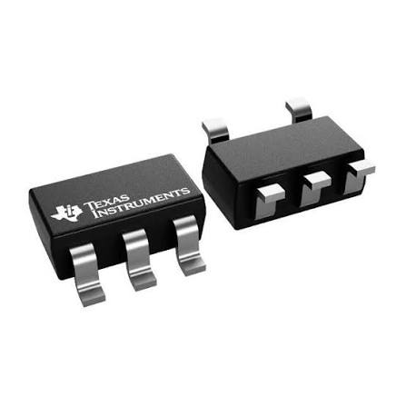
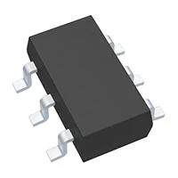
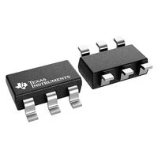
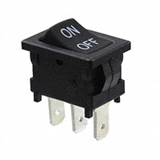
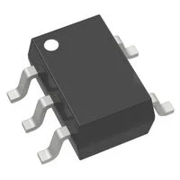

*Table 1: High-Side Current Sense Amplifier & Shunt (Power Subsystem)*

**High-Side Current Sense Amplifier & Shunt (Power Subsystem)**

| **Solution**                                                                                                                                                                                      | **Pros**                                                                                                                                    | **Cons**                                                                                            |
| ------------------------------------------------------------------------------------------------------------------------------------------------------------------------------------------------- | ------------------------------------------------------------------------------------------------------------------------------------------- | --------------------------------------------------------------------------------------------------- |
|  Option 1.  INA180A1IDBVR Current Sense Amp $0.85/each [link to product]([https://www.ti.com/lit/ds/symlink/ina180.pdf?HQS=dis-dk-null-digikeymode-dsf-pf-null-wwe&ts=1792297590728&ref_url=https%253A%252F%252Fwww.ti.com%252Fgeneral%252Fdocs%252Fsuppproductinfo.tsp%253FdistId%253D10%2526gotoUrl%253Dhttps%253A%252F%252Fwww.ti.com%252Flit%252Fgpn%252Fina180])                 | \* Wide common-mode input range (2.7V to 26V) independent of supply \* High accuracy with low offset voltage (150 µV max) \* Compact SOT-23-5 package saves PCB space                                               | \* Requires precise, low-value external current shunt resistor \* Fixed gain variant must be selected at purchase. |
|  \* Option 2.  \* MAX44284EAUT+T Current Sense Amp  \* $1.42/each  \* [Link to product]([http://www.digikey.com/product-detail/en/636L3I001M84320/CTX936TR-ND/2292940](https://www.analog.com/media/en/technical-documentation/data-sheets/max44284.pdf)) | \* Ultra-low supply current consumption (21 µA)  \* Extremely low input offset voltage for high precision   \* Wide dynamic operating range | * Higher unit cost compared to Texas Instruments alternatives  \* Potential supply chain lead time fluctuations                                                         |

**Choice:** Option 1: INA180A1IDBVR Current Sense Amp

**Rationale:** The INA180 offers an optimal balance of cost, high common-mode voltage handling, and factory-trimmed gain accuracy. Using a dedicated current-sense IC avoids the CMRR degradation common with discrete differential amplifier circuits while keeping the board layout compact.

*Table 1: Voltage Regulators (Power Subsystem)*

**Voltage Regulators (Power Subsystem)**

| **Solution**                                                                                                                                                                                      | **Pros**                                                                                                                                    | **Cons**                                                                                            |
| ------------------------------------------------------------------------------------------------------------------------------------------------------------------------------------------------- | ------------------------------------------------------------------------------------------------------------------------------------------- | --------------------------------------------------------------------------------------------------- |
|  Option 1.  LM7805CT Linear Regulator $0.65/each [link to product]([[http://www.digikey.com/product-detail/en/636L3I001M84320/CTX936TR-ND/2292940](https://www.analog.com/media/en/technical-documentation/data-sheets/max44284.pdf)](https://www.ti.com/lit/ds/symlink/lm7800.pdf))                 | \* Simple implementation requiring minimal external capacitors \* Robust internal thermal overload and short-circuit protection \* Through-hole package is easy to prototype and solder                                               | \* Low efficiency when stepping down from higher voltages (high thermal dissipation) \* Fixed 5V output voltage only. |
|  \* Option 2.  \* TPS54302DDAR Step-Down Buck Regulator  \* $1.10/each  \* [Link to product]([http://www.digikey.com/product-detail/en/636L3I001M84320/CTX936TR-ND/2292940](https://www.ti.com/lit/ds/symlink/tps54302.pdf?ts=1783496645768)) | \* High power conversion efficiency (up to 95%) minimizing heat dissipation \* Supports continuous output currents up to 3A  \* Adjustable output voltage via feedback resistors | * Requires external inductor and filter capacitors (larger layout)  \* Surface-mount thermal pad requires careful soldering                                                         |

**Choice:** Option 2:TPS54302DDAR Step-Down Buck Regulator

**Rationale:** Switching buck regulators like the TPS54302 are essential for our handheld system to prevent excessive power loss and thermal buildup compared to linear regulators, especially when dropping battery voltage down to logic and sensor levels.

*Table 1: Protection / Power Switch (Power Subsystem)*

**Protection / Power Switch (Power Subsystem)**

| **Solution**                                                                                                                                                                                      | **Pros**                                                                                                                                    | **Cons**                                                                                            |
| ------------------------------------------------------------------------------------------------------------------------------------------------------------------------------------------------- | ------------------------------------------------------------------------------------------------------------------------------------------- | --------------------------------------------------------------------------------------------------- |
|  Option 1.  Rocker Power Switch (12V/10A) $1.20/each [link to product]([http://www.digikey.com/product-detail/en/ECS-40.3-S-5PX-TR/XC1259TR-ND/827366](https://www.littelfuse.com/assetdocs/littelfuse-c-k-rocker-d-series-datasheet?assetguid=8731c953-f4bd-4993-b6ef-d4e1e9d52f9c))                 | \* High current handling capacity (>10A safely) \* Clear tactile feedback for physical on/off user status \* Panel-mount design secure against mechanical shock                                               | \* Manual electromechanical switch (cannot be toggled via software) \* Bulkier physical footprint on enclosure. |
|  \* Option 2.  \* MAX17613 High-Voltage Overvoltage Protector IC  \* $2.15/each  \* [Link to product]([http://www.digikey.com/product-detail/en/636L3I001M84320/CTX936TR-ND/2292940](https://www.analog.com/media/en/technical-documentation/data-sheets/MAX9940.pdf)) | \* Automatic electronic overvoltage and reverse-polarity protection  \* Integrated low-resistance MOSFET switch   \* Compact IC package | * Higher component unit cost  \* Does not provide a physical mechanical disconnect                                                         |

**Choice:** Option 1: Rocker Power Switch (12V/10A)

**Rationale:** A robust mechanical power switch provides an unmistakable master disconnect for the handheld battery pack, ensuring safety during transport and servicing while easily handling total system startup surge currents.
