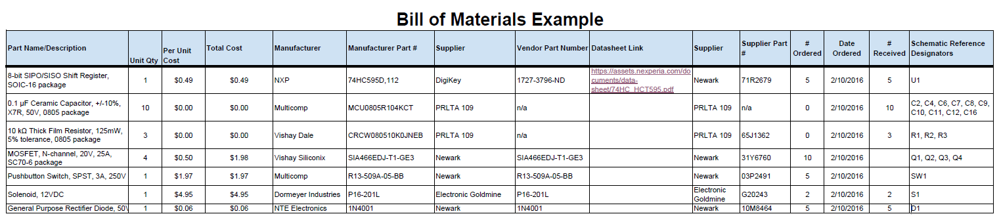

## Overview
This page lists every part on the power board schematic (`TEST_304.kicad_sch`): input protection, an LM7805 logic rail, a TPS54302 5 V buck for the motor supply, low-side current sense, the PIC18F57Q43 Curiosity Nano, UART ribbon, spare GPIO headers, debug LEDs and test points. The BOM was exported from KiCad (`bom_csv_grouped_by_value`) and sorted by vendor; all parts are ordered from **Digi-Key** on three class order forms. Order quantities are the schematic quantity plus spares per the class rules, trimmed to stay under the $60 budget. Unit prices are estimates at quantity 1 and will be confirmed at checkout; rows marked "(verify)" need the exact part number confirmed.

## Bill of Materials

*Table 1: Bill of materials for the power board (all Digi-Key).*

| **Part Name/Description** | **Qty** | **Unit Cost** | **Total Cost** | **Manufacturer** | **Manufacturer #** | **Vendor Link** | **Datasheet Link** | **Schematic Reference Designators** |
|:--------------------|:----|:---------------|:-----|:--------|:-----|:-----|:----|:-----|
| 0.1uF 50V X7R 0805 | 6 | $0.10 | $0.60 | Samsung | CL21B104KBCNNNC | [DigiKey](https://www.digikey.com/en/products/result?keywords=CL21B104KBCNNNC) | see vendor page | C1 |
| 0.1uF 16V X7R 0805 | 10 | $0.10 | $1.00 | Samsung | CL21B104KOCNNNC | [DigiKey](https://www.digikey.com/en/products/result?keywords=CL21B104KOCNNNC) | see vendor page | C3, C4, C7, C10 |
| 1uF 16V X7R 0805 | 5 | $0.10 | $0.50 | Samsung | CL21B105KOFNNNG | [DigiKey](https://www.digikey.com/en/products/result?keywords=CL21B105KOFNNNG) | see vendor page | C2 |
| 0.33uF 50V X7R 0805 | 5 | $0.15 | $0.75 | Samsung | CL21B334KBFNNNE (verify) | [DigiKey](https://www.digikey.com/en/products/result?keywords=0.33uF+50V+0805+X7R) | see vendor page | C5 |
| 10uF 50V X7R 1210 | 2 | $0.60 | $1.20 | Samsung | CL32B106KBJNNNE | [DigiKey](https://www.digikey.com/en/products/result?keywords=CL32B106KBJNNNE) | see vendor page | C6 |
| 22uF 10V X5R 1210 | 4 | $0.45 | $1.80 | Samsung | CL32A226MPJNNNE | [DigiKey](https://www.digikey.com/en/products/result?keywords=CL32A226MPJNNNE) | see vendor page | C8, C9 |
| 330 ohm 1% 0805 | 6 | $0.10 | $0.60 | Yageo | RC0805FR-07330RL | [DigiKey](https://www.digikey.com/en/products/result?keywords=RC0805FR-07330RL) | see vendor page | R1, R2 |
| 10k 1% 0805 | 6 | $0.10 | $0.60 | Yageo | RC0805FR-0710KL | [DigiKey](https://www.digikey.com/en/products/result?keywords=RC0805FR-0710KL) | see vendor page | R3, R7 |
| 1k 1% 0805 | 8 | $0.10 | $0.80 | Yageo | RC0805FR-071KL | [DigiKey](https://www.digikey.com/en/products/result?keywords=RC0805FR-071KL) | see vendor page | R5, R6, R8 |
| 100k 1% 0805 | 5 | $0.10 | $0.50 | Yageo | RC0805FR-07100KL | [DigiKey](https://www.digikey.com/en/products/result?keywords=RC0805FR-07100KL) | see vendor page | R9 |
| 73.2k 1% 0805 (buck FB divider) | 5 | $0.10 | $0.50 | Yageo | RC0805FR-0773K2L | [DigiKey](https://www.digikey.com/en/products/result?keywords=RC0805FR-0773K2L) | see vendor page | R10 |
| 10k 1% 0805 (buck FB divider) | 5 | $0.10 | $0.50 | Yageo | RC0805FR-0710KL | [DigiKey](https://www.digikey.com/en/products/result?keywords=RC0805FR-0710KL) | see vendor page | R11 |
| 0.1 ohm 2W 2512 shunt | 2 | $0.55 | $1.10 | TBD (verify) | 2512 0.1R 2W (verify) | [DigiKey](https://www.digikey.com/en/products/result?keywords=2512+0.1+ohm+2W+current+sense) | see vendor page | R4 |
| LED red 0805 | 3 | $0.30 | $0.90 | Lite-On | LTST-C171KRKT | [DigiKey](https://www.digikey.com/en/products/result?keywords=LTST-C171KRKT) | see vendor page | D1 |
| LED yellow 0805 | 3 | $0.30 | $0.90 | Lite-On | LTST-C171KSKT | [DigiKey](https://www.digikey.com/en/products/result?keywords=LTST-C171KSKT) | see vendor page | D2 |
| LED green 0805 (power) | 3 | $0.30 | $0.90 | Lite-On | LTST-C171KGKT | [DigiKey](https://www.digikey.com/en/products/result?keywords=LTST-C171KGKT) | see vendor page | D4 |
| 1N5822 3A 40V Schottky DO-201AD | 3 | $0.55 | $1.65 | onsemi | 1N5822RLG | [DigiKey](https://www.digikey.com/en/products/result?keywords=1N5822RLG) | see vendor page | D3 |
| 3A hold polyfuse 16V 1812 | 2 | $0.60 | $1.20 | Littelfuse | 1812L300/16 (verify) | [DigiKey](https://www.digikey.com/en/products/result?keywords=1812+polyfuse+3A+hold+16V) | see vendor page | F1 |
| 10uH >=4A sat, 7x7mm shielded | 2 | $1.20 | $2.40 | Bourns | SRP7028A-100M | [DigiKey](https://www.digikey.com/en/products/result?keywords=SRP7028A-100M) | see vendor page | L1 |
| Barrel jack 2.1mm, horizontal | 2 | $1.10 | $2.20 | CUI Devices | PJ-002A | [DigiKey](https://www.digikey.com/en/products/result?keywords=PJ-002A) | see vendor page | J1 |
| JST XH 2-pos header B2B-XH-A | 5 | $0.15 | $0.75 | JST | B2B-XH-A(LF)(SN) | [DigiKey](https://www.digikey.com/en/products/detail/jst-sales-america-inc/B2B-XH-A-LF-SN/1651045) | [datasheet](https://www.jst-mfg.com/product/pdf/eng/eXH.pdf) | J4, J5, J6 |
| JST XH 2-pos housing XHP-2 | 5 | $0.10 | $0.50 | JST | XHP-2 | [DigiKey](https://www.digikey.com/en/products/result?keywords=XHP-2) | [datasheet](https://www.jst-mfg.com/product/pdf/eng/eXH.pdf) | J4, J5, J6 (mating) |
| JST XH crimp contacts SXH-001T-P0.6 | 16 | $0.05 | $0.80 | JST | SXH-001T-P0.6 | [DigiKey](https://www.digikey.com/en/products/result?keywords=SXH-001T-P0.6) | [datasheet](https://www.jst-mfg.com/product/pdf/eng/eXH.pdf) | J4, J5, J6 (mating) |
| 1x40 male header 2.54mm (snap to 10/10/10/12) | 2 | $0.60 | $1.20 | Sullins | PRPC040SAAN-RC | [DigiKey](https://www.digikey.com/en/products/result?keywords=PRPC040SAAN-RC) | see vendor page | J2, J3, J7, J8 |
| 2x4 IDC shrouded header 2.54mm | 2 | $0.70 | $1.40 | TBD (verify) | 2x4 IDC shrouded header (verify) | [DigiKey](https://www.digikey.com/en/products/result?keywords=2x04+shrouded+header+2.54mm) | see vendor page | J9 |
| SPDT slide switch (Nidec CAS-120A1) | 2 | $0.90 | $1.80 | Nidec Copal | CAS-120A1 | [DigiKey](https://www.digikey.com/en/products/result?keywords=CAS-120A1) | see vendor page | SW1 |
| Test point SMD pad 2.0mm | 8 | $0.45 | $3.60 | Keystone | Keystone 5019 | [DigiKey](https://www.digikey.com/en/products/result?keywords=5019) | see vendor page | TP1-TP7 |
| LM7805 TO-220 (logic only) | 2 | $0.60 | $1.20 | STMicroelectronics | L7805CV | [DigiKey](https://www.digikey.com/en/products/result?keywords=L7805CV) | [datasheet](https://www.st.com/resource/en/datasheet/l78.pdf) | U1 |
| MCP6002-I/SN dual op amp SOIC-8 | 3 | $0.45 | $1.35 | Microchip | MCP6002-I/SN | [DigiKey](https://www.digikey.com/en/products/result?keywords=MCP6002-I%2FSN) | see vendor page | U2 |
| MCP6002-I/P dual op amp DIP-8 (breadboard) | 1 | $0.55 | $0.55 | Microchip | MCP6002-I/P | [DigiKey](https://www.digikey.com/en/products/result?keywords=MCP6002-I%2FP) | see vendor page | U2 (breadboard) |
| TPS54302DDCR 5V buck, SOT-23-6 | 3 | $0.95 | $2.85 | Texas Instruments | TPS54302DDCR | [DigiKey](https://www.digikey.com/en/products/detail/texas-instruments/TPS54302DDCR/6572466) | [datasheet](https://www.ti.com/lit/ds/symlink/tps54302.pdf) | U3 |
| PIC18F57Q43 Curiosity Nano DM164150 | 1 | $10.19 | $10.19 | Microchip | DM164150 | [DigiKey](https://www.digikey.com/en/products/detail/microchip-technology/DM164150/11586705) | [datasheet](https://www.microchip.com/en-us/development-tool/DM164150) | U4 |
| 1x28 female header 2.54mm (Nano socket) | 2 | $1.20 | $2.40 | TBD (verify) | 1x28 female header (verify) | [DigiKey](https://www.digikey.com/en/products/result?keywords=1x28+female+header+2.54mm) | see vendor page | U4 (sockets) |

**Estimated subtotal: $49.19** (before tax and shipping).

## Notes
* Items likely stocked in TECH 162 (resistors, capacitors, LEDs, headers, fuses) can be removed from the order after checking the parts closet.
* Test points, headers and breadboard-compatible parts (MCP6002-I/P, 1x40 headers) are included for debugging and prototyping.
* Datasheets are to be saved in the repository's `datasheets/` folder.

## Bill of Materials Example (as Image)
{style width: "2000"}
**Figure 2:** Example Bill of Materials as a screenshot.

As you can see, the text can be difficult to read without opening the image.
